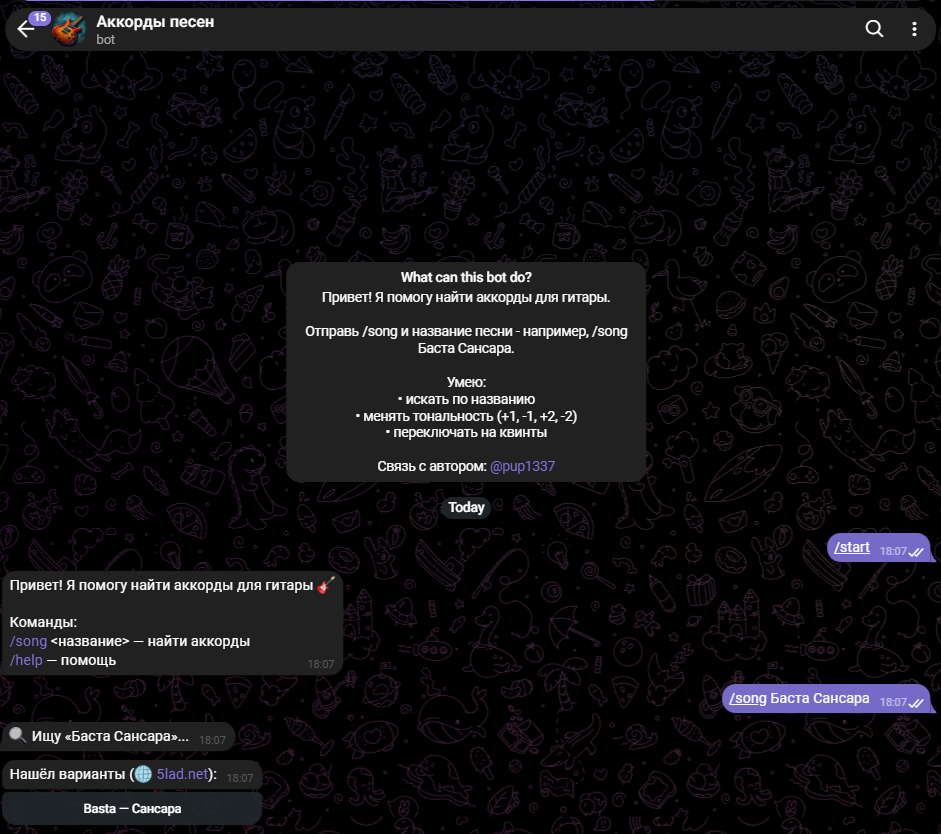
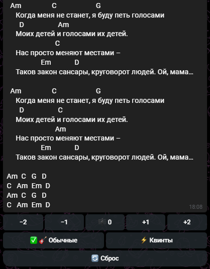
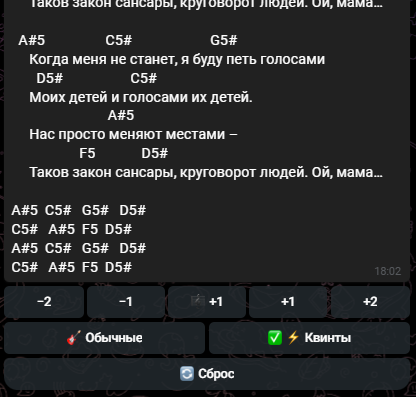

# Chords Helper Bot 🎸

Telegram-бот для поиска аккордов для гитары с транспонированием
и конвертацией в квинты.

## 🚀 Возможности

- 🔍 Поиск аккордов по названию песни и исполнителя
- 🌐 Каскадный поиск: ручная база → 5lad.net → mytabs.ru
- 🎼 Транспонирование тональности на ±1, ±2 полутона (inline-кнопки)
- ⚡ Конвертация обычных аккордов ↔ квинты (power chords)
- 💾 Ручная база песен через админ-команду `/add`
- 🔔 Уведомления админу о ненайденных песнях
- 🎯 Умный поиск с нормализацией (пробелы, c/z, k/s-замены)

## 🖼 Скриншоты

| Поиск песни | Аккорды с кнопками | Транспонирование |
|---|---|---|
|  |  |  |

## 🛠 Стек

- Python 3.13
- aiogram 3 - Telegram Bot API
- requests + BeautifulSoup4 - парсинг сайтов
- SQLite - ручная база песен
- python-dotenv - конфигурация
- Amvera - хостинг (работает 24/7)

## 📁 Структура проекта

```
tg-bot-chords/
├── bot.py              # Точка входа, команды и inline-кнопки
├── parser_5lad.py      # Парсер 5lad.net (указатель + песни)
├── parser_mytabs.py    # Парсер mytabs.ru (с транслитерацией и заменами)
├── chords.py           # Транспонирование и конвертация в квинты
├── storage.py          # SQLite для ручной базы
├── config.py           # Загрузка токена из .env
├── amvera.yaml         # Конфигурация для деплоя
├── requirements.txt
├── .env.example
└── README.md
```

## 🎮 Команды бота

| Команда | Описание |
|---|---|
| `/start` | Приветствие и список команд |
| `/song <название>` | Найти аккорды (можно с исполнителем) |
| `/add` | Добавить песню в ручную базу (только админ) |
| `/list` | Список сохранённых песен (только админ) |
| `/del <id>` | Удалить песню из базы (только админ) |
| `/help` | Справка |

## 💡 Как это работает

1. Пользователь отправляет `/song Баста Сансара`.
2. Бот ищет в **ручной базе** → затем на **5lad.net** → затем на **mytabs.ru**.
3. Показывает найденные варианты с inline-кнопками.
4. После выбора - аккорды с кнопками управления:
   - `[−2] [−1] [🎼 +0] [+1] [+2]` - транспонирование
   - `[🎸 Обычные] [⚡ Квинты]` - переключение типа аккордов
   - `[🔄 Сброс]` - вернуть оригинал
5. Если ничего не нашлось - **уведомление админу** для ручного добавления.

## ⚙️ Установка и запуск

1. Клонируй репозиторий:
   ```bash
   git clone https://github.com/orbit-fix/tg-bot-chords.git
   cd tg-bot-chords
   ```

2. Создай виртуальное окружение:
   ```bash
   python -m venv .venv
   .venv\Scripts\activate  # Windows
   # source .venv/bin/activate  # Linux/macOS
   ```

3. Установи зависимости:
   ```bash
   pip install -r requirements.txt
   ```

4. Создай `.env`:
   ```
   BOT_TOKEN=токен_от_BotFather
   ```

5. Запусти:
   ```bash
   python bot.py
   ```

## 🌐 Деплой

Бот работает на **Amvera** в регионе Warsaw. Конфигурация - в `amvera.yaml`.

## 📌 Что можно доработать

- Поддержка ещё источников (amdm.ru через прокси)
- Отправка аппликатур аккордов
- Сохранение избранных песен у пользователей
- Веб-панель для управления базой

## 📄 Лицензия

MIT